<div align="center">

# CanonicalPath / CanonicalFS

**Deterministic path identity across runtimes. Root-bound filesystem access where real I/O begins.**

[English](./README.md) |
[Language coverage](./docs/language-coverage.md) |
[Targets](./docs/language-targets.md) |
[Path contract](./docs/path-identity-contract.md) |
[Verification](./docs/verification.md) |
[Security](./SECURITY.md)

<p>
  <a href="./packages/go"></a>
  <a href="./packages/ts">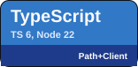</a>
  <a href="./packages/javascript-standalone"></a>
  <a href="./packages/unity">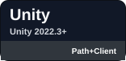</a>
  <a href="./packages/csharp">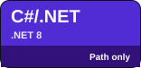</a>
  <a href="./packages/powershell/CanonicalPath"></a>
  <a href="./packages/bash-wrapper">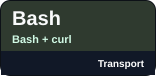</a>
  <a href="./packages/windows-cmd-batch-wrapper">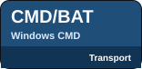</a>
  <a href="./packages/python">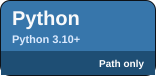</a>
  <a href="./packages/rust">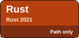</a>
  <a href="./packages/c">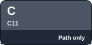</a>
  <a href="./packages/cpp">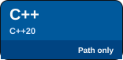</a>
  <a href="./packages/swift">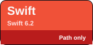</a>
  <a href="./packages/kotlin">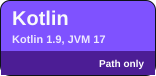</a>
  <a href="./packages/dart"></a>
  <a href="./packages/haxe">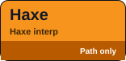</a>
  <a href="./packages/gdscript"></a>
</p>

<sub><strong>Path+FS</strong> = authoritative root-bound filesystem boundary; <strong>Path+Client</strong> = lexical identity plus daemon/client helpers; <strong>Transport</strong> = daemon wrapper only; <strong>Path only</strong> = lexical identity only.</sub>

</div>

Every runtime has a path library. CanonicalPath is for the moment where a path leaves one runtime and enters another.

A Unity editor tool may pass a path to a TypeScript MCP gateway, a Go daemon, a PowerShell script, a browser UI, WSL, Windows, and back again. Each layer can interpret `..`, slashes, drive-relative paths, UNC paths, symlinks, device names, and missing files differently. That is how path bugs become security bugs, broken artifacts, and hard-to-debug agent behavior.

The key idea:

- `CanonicalPath` says what path identity the tool means.
- `CanonicalFS` decides whether real filesystem I/O may touch that path under a root.
- Non-Go runtimes share lexical identity and delegate security-sensitive I/O to the Go daemon.

## What this repository provides

| Layer | Purpose | Filesystem access | Security claim |
|---|---|---:|---|
| `CanonicalPath` | Deterministic lexical identity, comparison, serialization, aliases, and shared test vectors. | No | Stable identity contract, not an I/O boundary. |
| `CanonicalFS` | Root-bound filesystem access for real reads/writes. | Yes | Go implementation is the authoritative filesystem security boundary. |
| Go daemon | Capability-style HTTPS/RPC boundary for non-Go clients. | Yes | Other languages delegate security-sensitive I/O to this daemon. |
| Client/runtime ports | Lexical helpers, wrappers, transports, Unity bridge adapters. | Usually no | Lexical/client-only unless explicitly documented otherwise. |

The split is intentional: **path identity is not file access**.

## Path identity contract

Choose the grammar of the input explicitly. `sourceHost: "posix"` preserves native POSIX component data, including literal backslash and a component such as `C:`. Read saved canonical strings with `sourceHost: "canonical"`; that mode performs no URI decoding, raw separator rewriting, WSL mapping, or extended-prefix removal. The default remains the raw cross-host grammar.

```ts
import { isEqual, join, normalize, relative, toPOSIX } from "@romanilyin/canonicalpath";

const root = normalize("/repo", { sourceHost: "posix" });
const path = normalize(String.raw`/repo/a\b`, { sourceHost: "posix" });
const saved = normalize(path, { sourceHost: "canonical" });

join(root, relative(root, saved)) === saved; // true
toPOSIX(saved) === path;                    // true
isEqual(saved, "/repo/a/b", { sourceHost: "canonical" }); // false

normalize("C:/repo", { sourceHost: "posix" }); // ./C:/repo (relative)
normalize("/C:/repo", { sourceHost: "posix" }); // /C:/repo (absolute)
```

The required `./` marker distinguishes a drive-like relative component from a Windows root. Canonical operations preserve this distinction. Extended drive/UNC cleanup retains the complete root, and WSL mapping uses one validated POSIX mount-root contract in both directions. Host serializers reject conversions that would change identity.

See the [complete path contract](./docs/path-identity-contract.md) for grammar, policies, and API errors, and the [migration guide](./docs/path-identity-migration.md) before changing persisted identities. The migration guide also covers the C options layout change and Godot byte validation. Existing strict raw filesystem validators remain in force.

## Why not just use `path.normalize`, `realpath`, or safe-join code?

Use standard libraries for ordinary local path manipulation. Use CanonicalPath when a path must cross process, language, operating-system, editor, or agent boundaries without changing meaning.

CanonicalPath is designed for:

- agent tools and MCP servers that must validate scoped paths before touching a project;
- build systems and generators that reference files before they exist;
- Unity/editor pipelines that need scoped paths such as `Assets/...`, `Packages/...`, artifacts, caches, and temp sessions;
- Windows/WSL/macOS/Linux workflows where host paths and project-relative paths are not the same thing;
- archive extraction and file tools where untrusted filenames must not escape a root;
- shared test vectors so Go, TypeScript, JavaScript, Python, Dart, C#, Swift, Kotlin, C, Rust, C++, Haxe, GDScript, PowerShell, Unity, and wrappers stay aligned.

## Current language coverage

| Group | Current surface | Filesystem security boundary |
|---|---|---|
| Go | `canonicalpath`, authoritative `canonicalfs`, daemon | Yes: Go `CanonicalFS` / daemon |
| TypeScript | `canonicalpath`, best-effort `canonicalfs` helpers, RPC/HTTP clients | Delegates to Go daemon for adversarial I/O |
| JavaScript standalone/browser | lexical `canonicalpath` | No filesystem access |
| PowerShell 5.1 / 7 | lexical module, typed HTTP client helpers, daemon transport | Delegates to Go daemon |
| Bash / Windows CMD-BAT | daemon transport wrappers | Delegates to Go daemon |
| Unity C# | managed lexical helpers, PathGuard/scoped validation, daemon transport, Burst-oriented surface | Delegates to Go daemon |
| Python, Dart/Flutter, C#/.NET, Swift, Kotlin, C, Rust, C++, Haxe, GDScript/Godot | vector-checked lexical `canonicalpath` surfaces | Lexical/client-only until native root-bound FS or daemon transport is reviewed |

See `docs/language-coverage.md` and `docs/language-targets.md` for the detailed matrix.

## Security boundary rule

For security-sensitive filesystem operations, do not build paths with string concatenation, `Join`, `normalize`, or `realpath` and then open them later.

Use the root-bound filesystem layer:

- In Go, use `CanonicalFS` directly.
- In TypeScript, Unity, C#, Python, PowerShell, Bash, CMD/BAT, or other runtimes, validate and serialize with the local CanonicalPath surface, then delegate real I/O to the Go daemon unless that runtime has a separately reviewed root-bound implementation.

## Problems this is meant to prevent

- Path traversal through `..`, absolute paths, encoded separators, or mixed separators.
- Windows-specific surprises: drive-relative paths like `C:foo`, UNC paths, reserved device names, alternate data streams, trailing dots/spaces, and NUL bytes.
- Symlink and reparse-point escape from a trusted project root.
- Time-of-check/time-of-use bugs from validating a path string and opening it later.
- Zip Slip style archive writes outside the destination directory.
- Agent/MCP tools writing into the wrong project, cache, artifact, package, or temp root.
- Broken identity when one runtime stores a path and another runtime interprets it differently.

## Security and identity migration in 2026.10.24-1

Daemon clients now require authenticated HTTPS and a trusted certificate/public-key pin, including on loopback. Create a fresh private bundle for each daemon launch; see [TLS bootstrap](./docs/daemon-tls-bootstrap.md). Git-ref directory identities use the versioned full SHA-256 format and require an explicit ownership-checked migration; see [identity v2 migration](./Documentation/IDENTITY_V2_MIGRATION.md). Bash `write-text` reads the payload from stdin. npm retries use the original attested immutable release assets and require the administrative trust cutover documented in [release process](./docs/release-process.md).

Native POSIX and canonical input now have explicit grammars, with preserved literal backslashes, relative markers, complete extended roots and consistent WSL mount configuration. Review [stored path identity migration](./docs/path-identity-migration.md) before changing persisted keys. The same guide covers the C options ABI change and Godot byte-input validation.

## Package identity and release

- Canonical repository: `https://github.com/romanilyin/canonicalpath`.
- TypeScript/npm package: `@romanilyin/canonicalpath`.
- JavaScript standalone npm package: `@romanilyin/canonicalpath-standalone`.
- Go module: `github.com/romanilyin/canonicalpath/packages/go`.
- Unity UPM package: `com.romanilyin.canonicalpath`.
- Unity npmjs scoped-registry package: `com.romanilyin.canonicalpath@2026.10.24-1`.
- Release version: `2026.10.24-1`.
- License model:
  - Repository default: `MIT`.
  - `@romanilyin/canonicalpath`: `MIT`.
  - `@romanilyin/canonicalpath-standalone`: `MIT`.
  - Go `canonicalpath` / `canonicalfs`: `MIT` unless a package directory says otherwise.
  - Unity UPM package `com.romanilyin.canonicalpath`: `LicenseRef-Stinger-Royalty-Free-EULA-1.0`.

The current full source release is documented in [release 2026.10.24-1](./docs/release-2026.10.24-1.md); Unity registry publication history is tracked in `docs/release-unity-2026.6.14-1.md`. The Go module tag is `packages/go/v0.2026.10-24.1`; see `docs/release-process.md` for the release tag policy.

## Status notes

- Planned language targets and allocation-check gates are tracked in `spec/language-targets.json` and summarized in `docs/language-targets.md`.
- Planned package directories are skeleton/not implemented placeholders unless listed as supported or as an early bridge target.
- Go packages require Go 1.25+ as of `2026.10.10-3` for the patched Windows ACL dependency. `canonicalfs.Rename` uses the root-bound implementation on Go 1.26+ and remains unsupported on older runtimes. Do not replace it with `filepath.Join(root, rel)` plus `os.Rename`.
- Security-sensitive builds must use a supported Go toolchain with current security patches. The workspace recommends Go 1.26.10 and CI/release workflows pin it for [GO-2026-6809](https://pkg.go.dev/vuln/GO-2026-6809); the module language floor remains Go 1.25. With standard `GOTOOLCHAIN=auto`, older bundled toolchains select this recommended version. A newer default toolchain must still contain the fix (Go 1.27 requires 1.27.3 or later). If automatic selection is disabled or `GOWORK=off` is used, provision the patched toolchain explicitly.

## Quick verification

After installing dependencies, run:

```bash
pnpm install
pnpm verify
```

Rust is required by `pnpm verify`: its runner checks, unit/documentation tests, and shared vectors must pass. A missing or broken Cargo toolchain fails the gate. Run that portion independently with `pnpm rust:verify`.

For Go race-sensitive filesystem tests, also run:

```bash
pnpm go:race
```

For active allocation and memory smoke gates, run:

```bash
pnpm alloc
```

If the `pnpm` shim is not available, use `corepack pnpm` for the same commands. Detailed verification commands live in `docs/verification.md`.

## When not to use this

CanonicalPath is not meant to replace normal path utilities for simple, trusted, single-language applications.

You probably do not need it if:

- paths never cross a language/process/OS boundary;
- filenames are fully trusted and intentionally allowed to point anywhere;
- you only need local display formatting;
- your OS sandbox/container already handles the security boundary and you do not need cross-runtime identity.

## Philosophy

This is not an attempt to invent a universal filesystem standard. It is a practical contract for codebases where path strings are already crossing too many boundaries.

[](https://xkcd.com/927/)

Image: xkcd “Standards”. The point is taken seriously: CanonicalPath should be used as a narrow contract at tool boundaries, not as a reason to rewrite every path helper in every program.

## License

This repository uses package-level licensing.

The repository default and the non-Unity CanonicalPath / CanonicalFS packages are
licensed under the MIT License. See `LICENSE.md` and `LICENSES/MIT.txt`.

The Unity UPM/npm package `com.romanilyin.canonicalpath` under `packages/unity`
is licensed separately under Stinger Royalty-Free EULA 1.0. See
`packages/unity/LICENSE.md` and `packages/unity/LICENSE.ru.md`.

The MIT License grants rights to use the code. It does not grant trademark
rights to use the CanonicalPath name, logo, or branding to imply official
endorsement.
